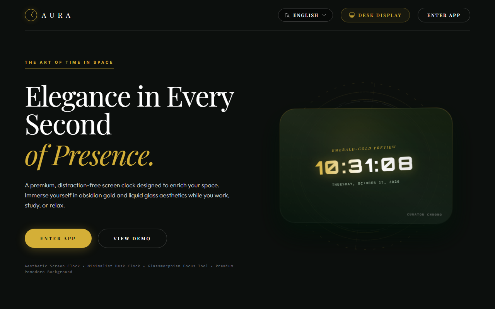
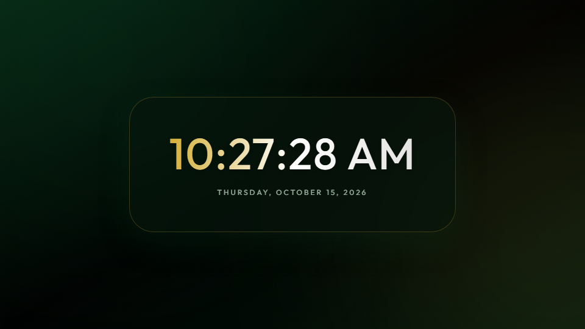
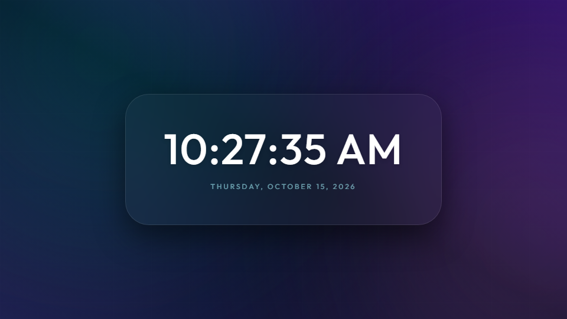
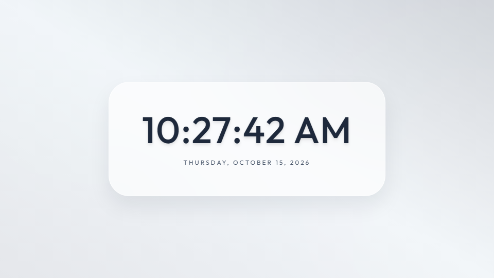
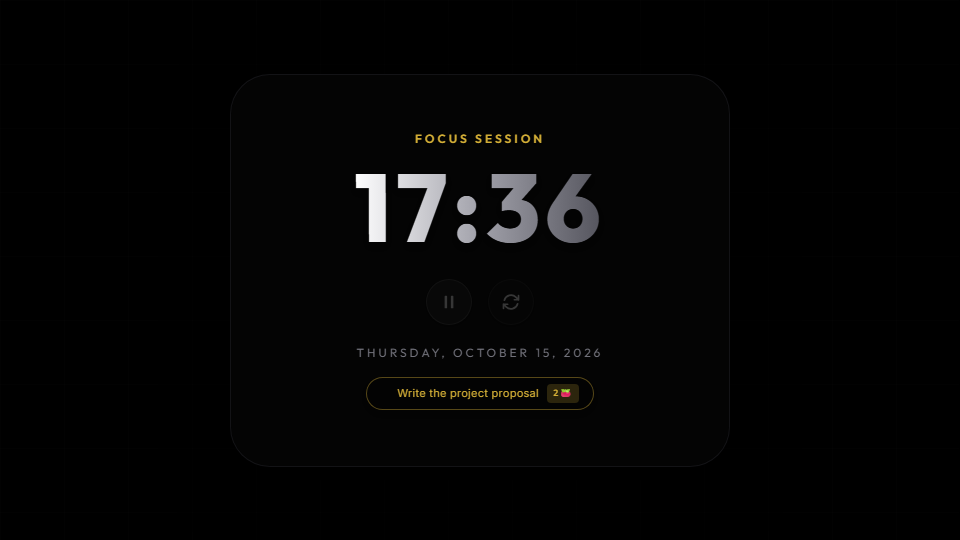
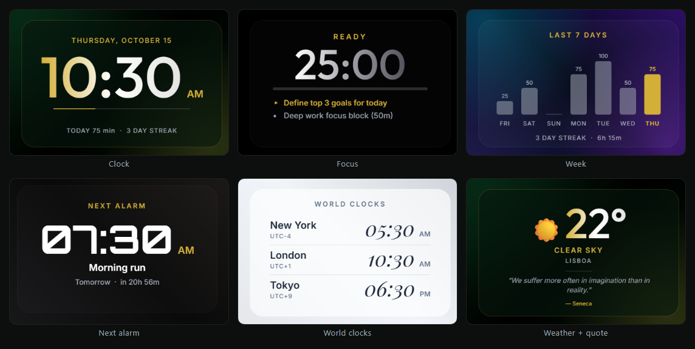

# AuraTime

A minimalist focus clock for your browser: Pomodoro, ambient sound and an optional USB desk display.

[](LICENSE)
[](https://angular.dev)
[](https://aura-time-iota.vercel.app)
<!-- CI badge not added on purpose: the repository has no workflow, so there is nothing to point at. -->

<p align="center">
  
</p>

## Contents

- [Features](#features)
- [Desk Display (USB screen)](#desk-display-usb-screen)
- [Quick start](#quick-start)
- [Browser extension](#browser-extension)
- [Keyboard shortcuts](#keyboard-shortcuts)
- [Privacy](#privacy)
- [Tech stack](#tech-stack)
- [Project structure](#project-structure)
- [Tests and contributing](#tests-and-contributing)
- [Credits](#credits)
- [Support](#support)
- [License](#license)

## Features

| Emerald Gold (default) | Liquid Glass | Light Glass |
| :---: | :---: | :---: |
|  |  |  |

### Clock and themes

- Six modes: clock, Pomodoro, world clocks, stopwatch, timer and alarms.
- Five themes: Emerald Gold, Liquid Glass, Obsidian Platinum, Dark Glass and Light Glass.
  Open `/app?theme=liquid-glass` to start in a given theme.
- Four fonts: Outfit, Orbitron, Inter and Playfair Display.
- Place the clock in the centre or in any corner, tilt it up to 45 degrees and scale it from 0.5x to 2x.
- 12 or 24 hour time, with or without seconds and date.
- The browser tab title shows the time or the running timer.
- Zen mode (`Z`) hides every control and leaves only the clock. `Esc` brings them back.
- Six languages: English, Portuguese, Spanish, French, German and Italian.

### Focus



- **Pomodoro:** 25 minutes of focus, then a 5 minute break, with a chime. The next phase starts by itself.
  The timer survives a reload and catches up after your computer sleeps.
- **Tasks:** an open-ended list. Mark one task as active and every finished Pomodoro is counted on it.
- **Analytics:** minutes and Pomodoros per day, current and best streak, and a chart of the last 7 days.
- **Scratchpad:** a notes drawer for quick thoughts while you work.

### Ambience

- A soundscape mixer with seven tracks: rain, thunder, fireplace, wind, brown noise, pink noise and
  binaural tones. Each has its own volume, plus a master volume, mute and four presets
  (Deep Work, Rainy Evening, Focus Binaural, Zen Breeze).
- Everything is synthesised with the Web Audio API. There are no audio files.
- An optional mechanical tick for the clock.

### Extras

- Weather from Open-Meteo (see [Privacy](#privacy)) and a daily quote.
- A floating mini clock (Picture-in-Picture) that stays on top of other windows.
- Alarms with repeat days, three sounds and snooze.
- A timer with quick presets (5, 10 and 25 minutes), and a stopwatch with laps.
- World clocks for New York, London and Tokyo.
- A dock of quick links.

## Desk Display (USB screen)

**AuraTime Desk Display** shows your clock, focus session, alarms and weather on a small 480x320 USB screen
next to your keyboard. It runs in the browser through the Web Serial API: no driver and no extra software.

<!--
  TODO (maintainer): add a photo of the Desk Display on a desk.
  Save it as docs/images/desk-display-photo.jpg (under 300 kB) and replace this comment with:
  
-->



*The six views, rendered with sample data.*

**Compatible screens:** Turing Smart Screen 3.5" class displays (USB `1A86:5722`, "rev. A" / UsbMonitor
protocol). Other models and revisions are not supported.

**Requirements:** Google Chrome or Microsoft Edge on a computer. Firefox, Safari and phone browsers cannot
talk to USB displays; the Desk Display page says so and shows a demo instead. Web Serial also needs a secure
page: HTTPS, or `localhost`. Over plain `http://` from a network address the browser turns it off, and the
page tells you to use HTTPS or localhost instead of blaming the browser.

**Operating systems:** AuraTime was developed and tried on Windows. On **Linux** your user needs permission
to open the serial device, usually by being in the `dialout` group (`sudo usermod -aG dialout $USER`, then log
out and in; some distributions use `uucp` or `tty`). On **macOS** the display's USB-serial chip (CH34x) may
need its driver installed if the system does not include one. These two notes follow how Web Serial works on
those systems; they have not been tried with a display.

### Set it up in three steps

1. **Open it.** Use the Desk Display button on the landing page, the entry in the clock's settings, or go
   to `/screen`. The page checks that your browser supports it.
2. **Connect the screen.** Plug it in, close the display's original software (only one program can use
   it), press *Connect display* and pick it from the list. After that it reconnects by itself.
3. **Choose the views.** Pick what rotates, set the brightness and the night schedule.

Before you connect anything, the preview runs in demo mode with sample data, so you can try every view.

### Views

| View | Shows |
| --- | --- |
| Clock | Date, time, a seconds bar, today's focus minutes and your streak |
| Focus | Pomodoro phase and time left, plus up to three open tasks ("Today's 3": the active one first) |
| Week | Focus minutes of the last 7 days, total and streak |
| Next alarm | The next enabled alarm and how long until it rings |
| World clocks | Up to three world clocks, with their UTC offset |
| Weather | Temperature, conditions, city and the daily quote |

The views rotate every 20 seconds. The Focus view stays on while a Pomodoro is running. A view with nothing
to show (for example Week before your first Pomodoro, or Next alarm with no alarms) is skipped. You can
turn any view off, or pin one.

### Good to know

- The display follows the app's theme, font and 12/24 hour setting. You can pin its own theme and font.
- Only the part of the picture that changed is sent, so it stays smooth.
- Brightness drops at night (23:00 to 07:00 by default) or the screen goes black. The picture also drifts
  a few pixels every minute to protect against burn-in.
- If you unplug it, or the computer sleeps, it reconnects and redraws on its own.
- **The page that drives the display needs a window of its own that the browser does not treat as hidden.**
  Browsers slow down background tabs and minimized windows (a tab in the background may run only once a
  minute). AuraTime copes with that, and does not resend the whole picture on every slow tick, but the display
  can then update late. Keep the Desk Display in its own visible window, or use the startup launcher below,
  which starts a dedicated window with the browser's throttling switched off. The page warns you when it is
  hidden while a display is connected.
- Only one Desk Display window drives the display at a time. A second one shows a preview and says
  "Desk Display active in another window"; it does not touch the USB port, and it takes over by itself when
  the first one is closed.
- Everything on the page is translated into the six app languages.
- The *Advanced* section holds flow control and troubleshooting options.

### Always on (Windows)

Keep the Desk Display page open in a window of its own. These PowerShell scripts do it at login:

```powershell
npm run build                                          # once
.\scripts\screen-startup.ps1 -ServeLocal -Minimized    # creates a shortcut in your Startup folder
.\scripts\screen-startup.ps1 -Remove                   # undo
```

At login the shortcut starts the local server, waits until the page answers and opens it in a dedicated
Chrome or Edge window (its own profile, with timer throttling disabled so the clock keeps running while
the window is minimized). Press *Connect display* once in that window the first time.
Use `-Url https://...` instead of `-ServeLocal` for a hosted copy (Web Serial needs HTTPS or `localhost`),
and `-DryRun` to see what would be created without creating it.

The shortcut starts PowerShell with `-ExecutionPolicy Bypass`. That applies only to these two scripts, so they
run even where scripts are blocked; your system-wide execution policy is not changed.

### Independence

AuraTime is an independent open-source project. It is not affiliated with, endorsed by or sponsored by any
display manufacturer. Product names belong to their owners and are used only to say what works.

## Quick start

You need Node.js 18.19.1+, 20.11.1+ or 22+ (the versions Angular 18 supports). Chrome or Edge is needed for
`npm test`, the extension and the Desk Display.

```bash
git clone https://github.com/JoaoMRB/AuraTime.git
cd AuraTime
npm install
npm start
```

Then open <http://localhost:4200>.

| Command | What it does |
| --- | --- |
| `npm start` | Dev server on port 4200 |
| `npm run build` | Production build (prerendered) in `dist/aura-time` |
| `npm test` | Unit tests with Karma and Jasmine, in Chrome |
| `npm run build:extension` | Production build, packaged as the new tab extension in `dist-extension/` |
| `npm run serve:ssr:AuraTime` | Serves the production build with the Node server (port 4000, or `$PORT`) |

For a single test run without a watcher: `npm test -- --watch=false --browsers=ChromeHeadless`.

## Browser extension

AuraTime can replace your new tab page in Chrome or Edge (Manifest V3).

```bash
npm run build:extension
```

1. Open `chrome://extensions` (or `edge://extensions`) and turn on **Developer mode**.
2. Click **Load unpacked** and select the `dist-extension` folder.
3. Open a new tab.

The new tab shows the clock. The monitor button in the top-right corner opens the Desk Display.
The build checks that the page has no inline scripts or event handlers, which an extension's content
security policy blocks, and fails if it finds any.

## Keyboard shortcuts

Shortcuts are ignored while you type in a field, and combinations with Ctrl, Alt or Cmd are left to the browser.

| Key | Action |
| --- | --- |
| `Space` | Start or pause the Pomodoro (in Pomodoro mode) |
| `R` | Reset the Pomodoro (in Pomodoro mode) |
| `,` | Open or close settings |
| `C` | Cycle the clock mode |
| `H` | Cycle the theme |
| `F` | Toggle fullscreen |
| `+` / `-` | Make the clock larger / smaller |
| `M` | Soundscape mixer |
| `T` | Tasks |
| `N` | Notes |
| `S` | Focus stats and streaks |
| `P` | Picture-in-Picture mini clock |
| `Z` | Zen mode |
| `Esc` | Close open panels and leave Zen mode and fullscreen |

## Privacy

- There are no accounts, no cookies, no tracking and no telemetry.
- Everything you create (settings, tasks, notes, alarms, stats, soundscape mix) stays in your browser's
  `localStorage`, under keys that start with `auratime_`. Clear the site's data to erase it.
- The app makes only two kinds of network requests:
  - **Weather:** the forecast comes from [Open-Meteo](https://open-meteo.com). If you allow the browser's
    optional location prompt, your coordinates are sent, rounded to two decimals (about 1 km). If you decline,
    Lisbon's coordinates are sent instead, until you pick a city in the clock's settings. Searching for a city
    sends the text you type to Open-Meteo's geocoding service. The city you choose is saved in your browser
    (`auratime_weather_city`). Like any web request, these also show your IP address to Open-Meteo. The
    forecast refreshes every 30 minutes while the app is open.
  - **Translations:** the language files, loaded from the same site as the app.
- Fonts are self-hosted. Quick links and the support links open other sites only when you click them.
- The Desk Display talks to your USB screen directly from the browser. Nothing is sent anywhere.

## Tech stack

- Angular 18 (standalone components, signals), TypeScript 5.5 and Tailwind CSS 3.4.
- Angular SSR with prerendering, served by Express (`server.ts`); static hosting config in `vercel.json`.
- Web APIs: Web Audio (soundscapes), Web Serial and Canvas 2D (Desk Display), Document Picture-in-Picture,
  Geolocation (optional).
- Karma and Jasmine for tests.

## Project structure

```text
src/app/
  components/
    clock/               the clock page (modes, panels, settings)
    landing-page/        the home page
    screen/              the Desk Display page
    desk-display-mock/   animated Desk Display preview for the landing page
  services/              settings, Pomodoro, tasks, analytics, soundscape, alarms, weather, i18n, ...
  services/screen/       Desk Display: snapshot -> views -> renderer -> serial protocol
  i18n/                  English fallback texts of the Desk Display
public/
  assets/i18n/           translations (en, pt, es, fr, de, it)
  fonts/                 self-hosted fonts
extension/               Manifest V3 manifest for the new tab extension
scripts/                 extension build, Windows startup scripts for the Desk Display
docs/images/             screenshots used in this README
```

Inside `services/screen/`, the data flows one way: `display-state.service` builds a snapshot from the app's
services, `screen-renderer` draws it on a 480x320 canvas, and `screen-output.service` sends the changed
rectangle through `serial-link.service`, using the byte layout in `turing-protocol`.

## Tests and contributing

There are over 250 unit tests. They cover the serial protocol bytes, the renderer pixel by pixel, the
serial link with a fake port, reconnection, the translations (every key exists in every language) and the
main components.

To contribute:

1. Create a branch from `main`.
2. Make your change, and add or update tests.
3. Make sure `npm test` and `npm run build` pass.
4. Open a pull request that describes what changed and why.

See [CHANGELOG.md](CHANGELOG.md) for what changed between versions.

## Credits

- Fonts, all under the [SIL Open Font License](https://openfontlicense.org/): Inter, Orbitron, Outfit and
  Playfair Display. Details in [public/fonts/README.md](public/fonts/README.md).
- Weather data by [Open-Meteo](https://open-meteo.com).

## Support

- **GitHub:** https://github.com/JoaoMRB/AuraTime. A star helps.
- **Buy me a coffee:** https://buymeacoffee.com/malog

## License

[MIT](LICENSE)
