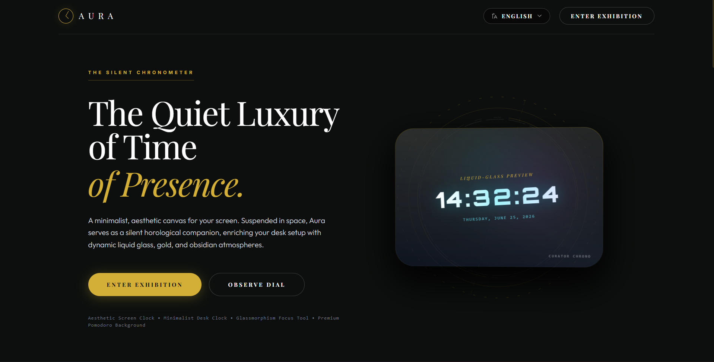

# AuraTime

> A minimalist, luxury screen clock.



## What is it?

AuraTime is a minimalist luxury screen clock and ambient focus hub designed to elevate your workspace into a deeply productive sanctuary.

**Features:**
- **Ambient Soundscapes (100% Procedural Web Audio):** Synthesized rain, crackling fireplace, thunder, wind, pink/brown noise, and binaural focus frequencies with independent track mixer & focus presets. Zero audio files or copyright concerns — purely mathematical browser synthesis.
- **Today's 3 & Focus Tasks:** Minimalist priority list integrated directly with Pomodoro cycles and progress tracking.
- **Quick Scratchpad:** Local instant notes drawer for deep work sessions.
- **Focus Analytics & Streaks:** Daily/weekly focus hours, Pomodoro counters, and streak visualization.
- **Real-Time Weather & Daily Quotes:** Open-Meteo weather integration and stoic inspiration.
- **Floating Mini Clock (Picture-in-Picture):** Pop out an always-on-top clock/pomodoro widget while coding or writing.
- **Chrome / Edge New Tab Extension:** Packaged Manifest V3 extension to transform every new tab into your zen dashboard.
- **Luxury Aesthetics:** Emerald Gold, Liquid Glass, Obsidian Platinum, and Frosted Glass themes with customizable angles, scales, and fonts.
- **Zen Screensaver Mode:** Anti-burn-in minimal immersion for OLED/ultrawide displays.
- **Desk Display (USB screen):** Show your clock, focus session, tasks, alarms, world clocks and weather on a small 480x320 USB screen, straight from Chrome or Edge. See [Desk Display](#desk-display-usb-screen).
- **Six languages:** English, Portuguese, Spanish, French, German and Italian.

## Keyboard Shortcuts

| Key | Action |
| --- | --- |
| `M` | Toggle Ambient Soundscape Mixer |
| `T` | Toggle Today's Focus Tasks |
| `N` | Toggle Quick Scratchpad Notes |
| `S` | Toggle Focus Stats & Streaks |
| `P` | Toggle Picture-in-Picture Mini Window |
| `Z` | Toggle Zen Mode (Screensaver) |
| `Esc` | Close all open drawers & panels |
| `Space` / `R` | Start-pause / reset the Pomodoro (Pomodoro mode) |
| `,` | Toggle Settings |
| `C` / `H` | Cycle clock mode / theme |
| `F` | Toggle fullscreen |
| `+` / `-` | Scale the clock up / down |

## Desk Display (USB screen)

**AuraTime Desk Display** shows your clock on a small 480x320 USB screen next to your keyboard. It is
compatible with Turing Smart Screen 3.5" (USB) displays ("rev. A" / UsbMonitor protocol, USB `1A86:5722`) and
runs entirely in the browser through Web Serial: **Google Chrome or Microsoft Edge on a computer**, no driver
and no extra software. AuraTime is an independent project, not affiliated with any display manufacturer.

1. Open `/screen` (the **Desk Display** button on the landing page, or the entry in the clock's settings;
   locally `http://localhost:4200/screen`).
2. **Check your browser**, then **Connect the display**: plug it in, close the display's original software
   (only one program can use it), press *Connect display* and pick it. Next time it reconnects by itself.
3. **Choose the views.** Without a display the preview runs in *demo mode* with sample data, so you can try
   everything first. Firefox, Safari and phones get an explanation instead of buttons that cannot work.

The display follows the app (theme, font, 12/24h clock, Pomodoro, today's tasks, focus stats, alarms, world
clocks and weather) or pins its own theme and font. Views: clock, focus (Pomodoro + today's 3 tasks), week
(last 7 days), next alarm / countdown, world clocks, and weather + quote. They rotate every 20 s (focus stays
on while a Pomodoro runs); views without content are skipped and you choose which ones rotate. Brightness
drops at night (23:00-07:00 by default, or a black screen), the picture drifts a few pixels every minute
against burn-in, and only the changed part of the image is sent. The *Advanced* section holds flow control and
troubleshooting options ("always send the full screen", "slow send"). Everything is available in English,
Portuguese, Spanish, French, German and Italian.

### Always on (start with Windows)

```powershell
npm run build                                    # once
.\scripts\screen-startup.ps1 -ServeLocal -Minimized # creates a shortcut in your Startup folder
.\scripts\screen-startup.ps1 -Remove                # undo
```

At login the shortcut starts the local server, waits until the page answers and opens it in a dedicated
Chrome/Edge window (own profile, timer throttling disabled so the clock keeps running when the window is
minimized or covered). Click **Connect display** once in that window the first time. Use `-Url https://...`
instead of `-ServeLocal` for a hosted copy (Web Serial needs HTTPS or `localhost`); add `-DryRun` to see
what would be created. If the display is unplugged or the PC wakes from sleep, the page reconnects and
redraws on its own.

## Quick Start

```bash
git clone https://github.com/JoaoMRB/AuraTime.git
cd AuraTime
npm install
npm start
```
Then open `http://localhost:4200`.

## Build as Chrome/Edge "New Tab" Extension

```bash
npm run build:extension
```
1. Open `chrome://extensions` (or `edge://extensions`) in your browser.
2. Enable **Developer mode**.
3. Click **Load unpacked** and select the generated `dist-extension` folder.
4. Open a new tab! It shows the clock; the monitor button in the top-right corner opens the Desk Display.

## Support

- **GitHub:** https://github.com/JoaoMRB/AuraTime
- **Buy me a coffee:** https://buymeacoffee.com/malog

---

Built with Angular, Tailwind CSS, and a passion for minimalism.
